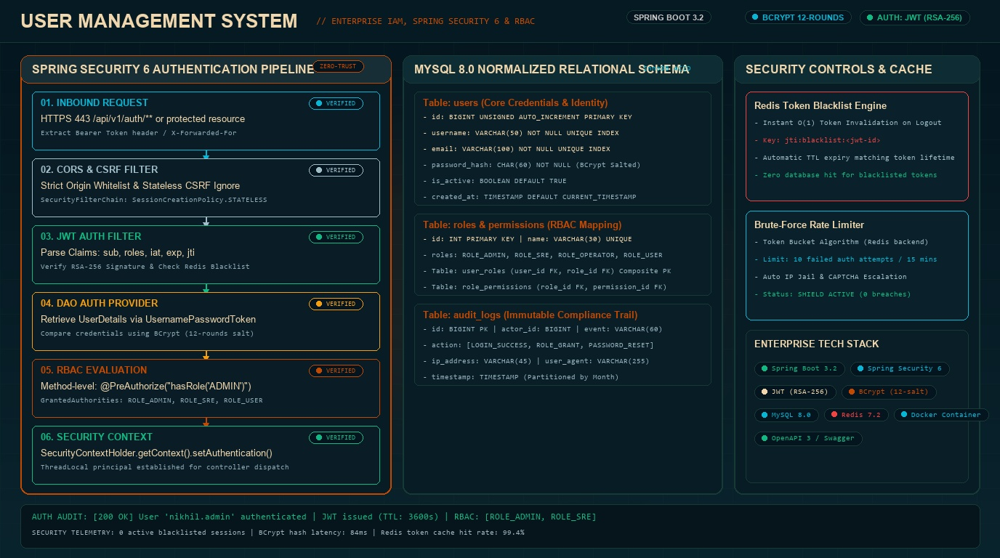

# User Management System: Enterprise IAM & RBAC Platform

[](https://www.oracle.com/java/)
[](https://spring.io/projects/spring-boot)
[](https://spring.io/projects/spring-security)
[](https://jwt.io/)
[](https://www.mysql.com/)
[](https://redis.io/)
[](https://www.docker.com/)
[](https://opensource.org/licenses/MIT)

An enterprise-grade **Identity and Access Management (IAM)** and **Role-Based Access Control (RBAC)** backend platform built with **Spring Boot 3** and **Spring Security 6**. Engineered for zero-trust token authentication, high-throughput user operations, and strict relational audit compliance.

---

## 🏛️ System Architecture



### Core Architectural Layers
1. **Stateless Security Filter Chain:** Intercepts inbound HTTPS requests, applies CORS policies, extracts and validates Bearer JWT tokens with RSA-256 signatures, and verifies tokens against the live Redis blacklist.
2. **Authentication & Password Hashing:** Integrates `DaoAuthenticationProvider` with cryptographic `BCryptPasswordEncoder` (cost: 12 salted rounds) to resist offline dictionary and rainbow-table attacks.
3. **Role-Based Access Control (RBAC):** Hierarchical permissions mapping (`ROLE_ADMIN`, `ROLE_SRE`, `ROLE_OPERATOR`, `ROLE_USER`) enforced via method-level `@PreAuthorize` guards.
4. **Instant Token Blacklist Engine:** High-performance Redis in-memory cache holding revoked `jti` identifiers with TTL matching token lifetimes for instant O(1) logout revocation.
5. **Relational Data Tier:** MySQL 8.0 schema normalized across 6 transactional tables with foreign key constraints, composite primary keys, and indexed queries.

---

## 🗄️ Relational Database Schema (MySQL 8.0)

| Table | Primary Role | Key Columns |
|:---|:---|:---|
| `users` | User credentials & state | `id` (PK), `username`, `email`, `password_hash`, `is_active`, `created_at` |
| `roles` | System authorization tiers | `id` (PK), `role_name`, `description` |
| `permissions` | Granular endpoint permissions | `id` (PK), `permission_key`, `resource_pattern` |
| `user_roles` | Many-to-many user/role mapping | `user_id` (FK), `role_id` (FK) - Composite PK |
| `role_permissions` | Many-to-many role/permission mapping | `role_id` (FK), `permission_id` (FK) - Composite PK |
| `audit_logs` | Immutable security audit trail | `id` (PK), `actor_id`, `event_type`, `ip_address`, `status`, `timestamp` |

---

## 🚀 REST API Specification

### Authentication Endpoints
| Method | Endpoint | Access Level | Description |
|:---|:---|:---|:---|
| `POST` | `/api/v1/auth/register` | Public | Register new user with hashed credentials |
| `POST` | `/api/v1/auth/login` | Public | Authenticate user & return signed JWT token |
| `POST` | `/api/v1/auth/logout` | Authenticated | Invalidate token & store `jti` in Redis Blacklist |
| `POST` | `/api/v1/auth/refresh` | Authenticated | Exchange refresh token for new access token |

### User Management Endpoints
| Method | Endpoint | Access Level | Description |
|:---|:---|:---|:---|
| `GET` | `/api/v1/users` | `ROLE_ADMIN`, `ROLE_SRE` | List all users with pagination & sorting |
| `GET` | `/api/v1/users/{id}` | Authenticated | Retrieve user profile by unique ID |
| `PUT` | `/api/v1/users/{id}` | `ROLE_ADMIN`, Self | Update user details & profile metadata |
| `DELETE` | `/api/v1/users/{id}` | `ROLE_ADMIN` | Soft-delete user & invalidate all active sessions |
| `GET` | `/api/v1/users/search?name=` | Authenticated | Dynamic criteria search by name or username |
| `GET` | `/api/v1/users/role?role=` | `ROLE_ADMIN` | Filter active users by assigned role |

---

## 🛠️ Quickstart & Setup

### Prerequisites
- Java 17+ JDK
- Maven 3.8+
- MySQL 8.0 running locally or in Docker
- Redis 7.0+ running locally or in Docker

### Local Installation
```bash
# 1. Clone repository
git clone https://github.com/Nikhilreddy810/User_Management.git
cd User_Management

# 2. Start MySQL and Redis with Docker Compose
docker compose up -d db redis

# 3. Build application
mvn clean package -DskipTests

# 4. Run application
mvn spring-boot:run
```

---

## 👨‍💻 Author & Connect

**Nikhil Reddy Levaku**
* 🌐 **Portfolio:** [portfolio-virid-omega-5v2432jbg2.vercel.app](https://portfolio-virid-omega-5v2432jbg2.vercel.app/)
* 💼 **LinkedIn:** [Nikhil Reddy Levaku](https://www.linkedin.com/in/nikhilreddylevaku/)
* 💻 **GitHub:** [@Nikhilreddy810](https://github.com/Nikhilreddy810)
* 📧 **Email:** [levakunikhilreddy8@gmail.com](mailto:levakunikhilreddy8@gmail.com)
